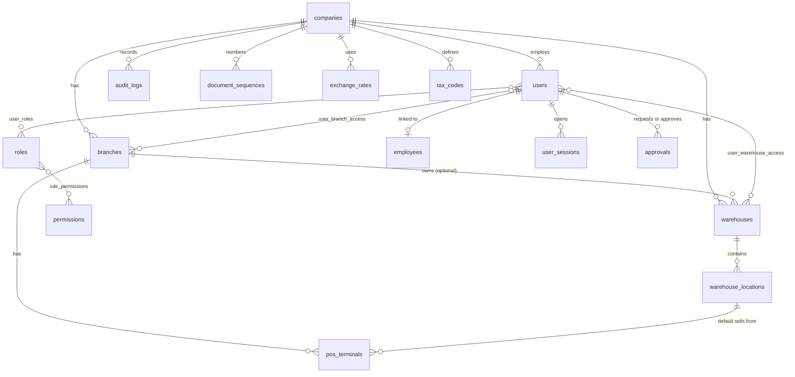

# Database design

Implements SRS section 11 on PostgreSQL 16 or later (developed on 18). All schema changes go through Alembic.

## Conventions

| Topic | Rule | SRS |
|---|---|---|
| Keys | UUID v7 for business records, generated in Python; `bigint` identity for high-volume append-only tables (`inventory_movements`, `audit_logs`) | 11.1 |
| Money | `NUMERIC(19,4)`; exchange rates `NUMERIC(20,8)`; average cost `NUMERIC(19,6)`; quantities `NUMERIC(19,4)` in base units. No floating-point columns anywhere | 11.1, NFR-INT-010 |
| Time | `TIMESTAMPTZ` in UTC; `business_date DATE` set by the server | 11.1, BR-SAL-008 |
| Scope | `company_id` on all company data; `branch_id`, `warehouse_id`, `terminal_id` where they apply | 11.1 |
| Audit columns | `created_at`, `updated_at`, `created_by`, `updated_by` on mutable records | brief |
| Soft delete | `deleted_at` on master data only (products, customers, suppliers, users and similar). Transactions are never deleted (BR-SAL-003) | brief, 8.3 |
| Drafts | `version` integer for optimistic locking | 11.1 |
| Immutability | Triggers reject UPDATE and DELETE on `inventory_movements` and `audit_logs`; posted documents are protected by status checks | 11.7, BR-INV-002 |
| Extensions | `pg_trgm` (product search), `btree_gist` (price-validity exclusion) | 11.1 |

## Tables by group and phase

Phase in brackets. Constraints listed are the ones the SRS treats as integrity rules.

### Organisation [1]
| Table | Key columns and constraints |
|---|---|
| companies | legal and trading names EN/KM, tax_id, base_currency, fiscal_year_start_month, settings JSONB |
| branches | company_id, code UQ(company_id, code), names EN/KM, address, phone, receipt_header, open_time, close_time, day_cutoff, status |
| warehouses | company_id, branch_id NULL = central, code UQ(company_id, code), status |
| warehouse_locations | warehouse_id, code UQ(warehouse_id, code), location_type CHECK in SRS list, is_available_for_sale |
| pos_terminals | branch_id, code UQ(company_id, code), default_location_id, printer_profile, cash_drawer, device_token_hash, status |
| terminal_cashiers | terminal_id, user_id PK both |
| currencies | code PK (USD, KHR), decimals, cash_rounding_increment |
| exchange_rates | company_id, from_currency, to_currency, rate NUMERIC(20,8) CHECK > 0, effective_at |
| tax_codes | company_id, code UQ, rate NUMERIC(9,4) CHECK 0..100, is_inclusive flag lives in company settings (V-01) |
| document_sequences | PK(company_id, doc_type, scope_key), prefix, next_value, padding; locked FOR UPDATE on allocation (BR-DOC-001) |

### Identity and audit [1, 2]
| Table | Key columns and constraints |
|---|---|
| permissions | code PK (`module.resource.action`), module, description |
| roles | company_id, code UQ(company_id, code), name, is_system, limits JSONB (discount %, override, refund, adjustment value, PO approval) |
| role_permissions | role_id, permission_code PK both |
| users | company_id, username UQ, email UQ (lower-case), password_hash, pin_hash, status, language, mfa_enabled, failed_login_count, locked_until, last_login_at, employee_id UQ NULL, deleted_at |
| user_roles | user_id, role_id PK both |
| user_branch_access | user_id, branch_id PK both. No rows means all company branches |
| user_warehouse_access | user_id, warehouse_id PK both |
| employees | company_id, code UQ, names EN/KM, position, branch_id, phone, status |
| user_sessions | user_id, refresh_token_hash UQ, family_id, device, terminal_id, created_at, last_seen_at, expires_at, absolute_expires_at, revoked_at, revoke_reason |
| password_reset_tokens | user_id, token_hash UQ, expires_at (30 min), used_at |
| login_attempts | username, ip, terminal_id, succeeded, attempted_at (rate limiting, FR-AUTH-008) |
| approvals | company_id, action, requester_id, approver_id CHECK approver ≠ requester unless self_approved flag, amount, token_hash UQ, expires_at, used_at |
| audit_logs | bigint id, company_id, occurred_at, user_id, action, module, entity_type, entity_id, branch_id, before JSONB, after JSONB, flagged, correlation_id, prev_hash, hash. UPDATE and DELETE blocked by trigger |

### Platform [1]
| Table | Key columns and constraints |
|---|---|
| idempotency_keys | PK(scope, key), request_hash, status IN_PROGRESS or COMPLETED, response_status, response_body JSONB, created_at (kept 7 days, 11.10) |
| outbox_events | bigint id, event_type, payload JSONB, created_at, published_at, attempts |

### Catalogue [3]
categories (hierarchical, up to 4 levels), brands, units_of_measure, products (type, sku UQ(company_id, sku), names EN/KM, base_uom_id locked after first movement, allow_fraction, quantity_precision, tax_code_id, status, min_selling_price), product_variants, unit_conversions UQ(product_id, from_uom_id) CHECK factor > 0, product_barcodes partial UQ(company_id, barcode) WHERE is_active, price_lists, product_prices with EXCLUDE USING gist on scope and `tstzrange(effective_from, effective_to)`, price_change_history, product_suppliers, product_stock_settings. Trigram GIN indexes on name_en and name_km.

### Inventory [4]
inventory_balances PK(location_id, product_id, variant_key, batch_key) CHECK(allow_negative OR on_hand ≥ 0) CHECK(reserved ≥ 0); inventory_movements bigint id, CHECK quantity_base > 0, CHECK at least one location, UQ(source_type, source_line_id, movement_type), reverses_movement_id UQ; stock_reservations; inventory_batches; stock_adjustments and lines; stock_transfers (CHECK source ≠ destination) and lines; stock_counts and lines (snapshot_qty, counted_qty, generated variance); inventory_alerts with partial UQ on open alerts per (type, product, warehouse).

### Sales and cash [5]
sales (UUID, receipt_no UQ(company_id, receipt_no), status and payment_status CHECKs, server-calculated totals CHECK grand_total ≥ 0, version, idempotency keys UQ(terminal_id, key)); sale_lines with snapshot columns and CHECK returned_quantity ≤ quantity; sale_payments with partial UQ(provider, provider_reference) and CHECK that cash payments have a session; payment_transactions; cashier_sessions with partial UQ(terminal_id) and UQ(cashier_id) WHERE status = 'OPEN'; cash_movements; cash_counts; sales_returns and lines; refunds; print_jobs.

### Purchasing and customers [6]
suppliers, supplier_contacts, purchase_orders and lines, goods_receipts (UQ post idempotency key) and lines, supplier_invoices with partial UQ on normalised invoice number per supplier (BR-PUR-003), purchase_returns and lines; customers (code UQ, phone index), customer_groups.

### Later [7, 8]
notifications, notification_reads, import_batches, import_errors, expenses, expense_categories, promotions, coupons, loyalty tables. Reports read existing tables; daily summary tables are added only if performance needs them (SRS 12.9).

## Entity relationships (phases 1 to 2)

The diagram is regenerated from the SQLAlchemy models at the end of each phase (`scripts/erd.py`), so it always shows the implemented database.

## Integrity: database versus application (SRS 11.7)

| Rule | Database | Application |
|---|---|---|
| Unique receipt numbers | UQ(company_id, receipt_no) | Sequence row locked at finalize |
| Duplicate requests | PK on idempotency_keys | Stored response replay |
| Non-negative stock | CHECK on balances | Policy check with a friendly error first |
| Movement immutability | Trigger blocks UPDATE and DELETE | Reversal service only |
| One posting per line | UQ(source_type, source_line_id, movement_type) | Status check under lock |
| One open session | Partial UQ indexes | Open-session check |
| Barcode uniqueness | Partial UQ on active barcodes | Form and import validation |
| Price overlaps | EXCLUDE with tstzrange | Preview validation |
| Audit immutability | Trigger blocks UPDATE and DELETE; hash chain | Insert-only service |

## Databases

| Database | Purpose |
|---|---|
| pims_db | Development. Created by `scripts/create_databases.py` only if missing; never dropped by any script |
| pims_test_db | Tests only. The test suite recreates its schema and refuses to run if the configured name is not a test database |
